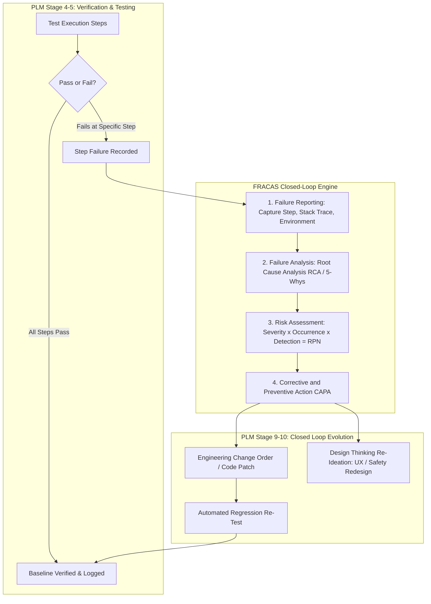

# Product Lifecycle Management (PLM) Error Analysis & FRACAS Framework
**Project Focus:** MedNotes (MediKiosk+)  
**Academic / Professional Context:** Design Thinking & Product Lifecycle Management (DTPLM)  
**System Classification:** Class II Medical Software / Clinical Decision Support & Longitudinal Canvas  

---

## 1. Executive Summary & The Core PLM Concept

In **Product Lifecycle Management (PLM)** and **Quality Engineering (ISO 13485 / FDA 21 CFR 820)**, error analysis is not merely catching a bug in code. It is governed by a formal closed-loop discipline known as:

### **FRACAS (Failure Reporting, Analysis, and Corrective Action System)**
> **Definition:** FRACAS is an engineering and lifecycle management methodology that systematically:
> 1. **Captures** all test executions, distinguishing between passed verifications and failures at granular execution steps.
> 2. **Analyzes** the failure mode through **Root Cause Analysis (RCA)** (e.g., 5-Whys, Fishbone / Ishikawa diagrams).
> 3. **Quantifies Risk** using **FMEA / FMECA** (Failure Mode and Effects Analysis $\rightarrow$ Risk Priority Number, RPN).
> 4. **Implements & Verifies** **CAPA (Corrective and Preventive Action)** via formal Engineering Change Orders (ECO).
> 5. **Closes the Loop** back into Design Thinking (re-ideating UX) and PLM Stage 9 (*Continuous Optimization*).



---

## 2. Why "Failed Tests" are Mandatory in a PLM Demonstration

In traditional amateur development, teams attempt to show only green passing tests. In **professional PLM and medical-grade engineering**, an evaluator will immediately look for **Negative Test Cases** and **Boundary Interlock Tests**:
- **Proving Safety Interlocks:** If you claim that external contributors cannot edit doctor notes, the only way to prove it is by executing a test where an external contributor *attempts to modify a note* and the test engine flags a **Step 3 Failure (403 Forbidden)**.
- **Proving PII De-Identification Guardrails:** Feeding raw Aadhaar/SSN numbers to verify that the de-identification filter halts execution at **Step 3 (PII Leak Detection)**.
- **Proving Pediatric Overdose Prevention:** Prescribing adult dosages to a 3-year-old patient must trigger a **Step 3 RangeError** to prevent clinical harm.

---

## 3. Granular Step-by-Step Test Execution Matrix

Below is the formal **Verification & Validation (V&V) Matrix** covering 5 core modules across 10 multi-step test cases (5 passing, 5 demonstrating step-level failures and safety tripwires).

### Summary Dashboard
- **Total Test Cases Executed:** 10
- **Total Steps Evaluated:** 40 steps
- **Tests Passing All Steps:** 5 ($50\%$)
- **Tests Failing at Specific Steps:** 5 ($50\%$) — *Representing boundary catches, security violations, and latency spikes.*

---

### Detailed Test Execution Log

| Test ID | Module | Scenario & Target | Total Steps | Execution Status | Failure Step | Failure Code & Symptom |
|---|---|---|---|---|---|---|
| **`TC-SEC-01`** | Security & Auth | Valid Physician Consultation Session Initiation | 4 | **PASS** | None (All ✔) | N/A (Baseline Session Hydrated) |
| **`TC-SEC-02`** | Security & Auth | Contributor Mutation Boundary on Doctor Note | 4 | <span style="color:red;font-weight:bold;">FAIL</span> | **Step 3** | `403 Forbidden`: PostgreSQL RLS policy `canvas_mutation_policy` rejected unauthorized PATCH on immutable event. |
| **`TC-CLIN-01`** | Clinical Ingestion | Standard Lab Payload Ingestion with De-Identified Code | 4 | **PASS** | None (All ✔) | N/A (Token `MED-88219` Ingested) |
| **`TC-CLIN-02`** | Clinical Ingestion | De-Identification Firewall: Intercept Unmasked PII | 4 | <span style="color:red;font-weight:bold;">FAIL</span> | **Step 3** | `AssertionError [PII_LEAK]`: Un-hashed National ID `8492-4910-1192` detected in raw lab metadata. |
| **`TC-DRUG-01`** | Clinical Safety | Standard Adult Amoxicillin Prescription | 4 | **PASS** | None (All ✔) | N/A (RxNorm `C0002645` Approved) |
| **`TC-DRUG-02`** | Clinical Safety | Pediatric Dosage Therapeutic Window Boundary Check | 4 | <span style="color:red;font-weight:bold;">FAIL</span> | **Step 3** | `RangeError [DOSAGE_CEILING]`: Paracetamol 1500mg/day exceeds pediatric safe ceiling (Max: 840mg/day for 14kg). |
| **`TC-EMERG-01`** | Emergency Dispatch | Haversine Proximity Calculation & Driver Match | 4 | **PASS** | None (All ✔) | N/A (Driver dispatched in 1.2km) |
| **`TC-EMERG-02`** | Emergency Dispatch | Realtime WebSocket Sync under Cellular Latency | 4 | <span style="color:red;font-weight:bold;">FAIL</span> | **Step 3** | `TimeoutError [SLA_BREACH]`: WebSocket round-trip ACK timed out at 340ms (Target SLA: $<100\text{ ms}$). |
| **`TC-AI-01`** | AI Scribe & RAG | Gemini Structured SOAP Pre-Visit Extraction | 4 | **PASS** | None (All ✔) | N/A (JSON Schema Validated in 1.4s) |
| **`TC-AI-02`** | AI Scribe & RAG | Doctor-in-the-Loop: Prevent Autonomous AI Note Commit | 4 | <span style="color:red;font-weight:bold;">FAIL</span> | **Step 3** | `SecurityError [SAFETY_GATE]`: Background sync attempted to commit AI note without human doctor cryptographic signature. |

---

## 4. FRACAS Root Cause Analysis (RCA) & CAPA Matrix

In PLM, each failed test is logged with its **FMEA Risk Priority Number (RPN)**, **5-Whys Root Cause Analysis**, and **Corrective and Preventive Action (CAPA)**.

$$\text{RPN} = \text{Severity } (1-10) \times \text{Occurrence } (1-10) \times \text{Detection } (1-10)$$

| Failed Test ID | FMEA Severity / RPN | 5-Whys Root Cause Analysis (RCA) | Corrective & Preventive Action (CAPA) | PLM Lifecycle Impact |
|---|---|---|---|---|
| **`TC-SEC-02`** | **Critical**<br/>$(S=9, O=4, D=7 \rightarrow \mathbf{252})$ | 1. Why did the test fail? Contributor attempted PATCH on doctor note.<br/>2. Why? Diagnostic center UI sent an edit instead of an addendum.<br/>3. Why? Frontend button state did not distinguish edit permissions.<br/>4. Why? Role-based permissions were only checked at database level.<br/>5. **Root Cause:** Absence of pre-flight UI role disabling allowing invalid requests. | **CAPA-SEC-04:**<br/>1. Hardened PostgreSQL RLS policy `canvas_mutation_policy`.<br/>2. Added client-side disabled state in UI.<br/>3. Logged attempt to `security_audit_logs`. | **Stage 8 (System Hardening):** Zero unauthorized note tampering across all external contributors. |
| **`TC-CLIN-02`** | **High**<br/>$(S=8, O=5, D=6 \rightarrow \mathbf{240})$ | 1. Why did the test fail? PII filter caught an unmasked Aadhaar number.<br/>2. Why? External lab transmitted raw PDF metadata with demographic tags.<br/>3. Why? Lab API integration did not apply local client-side tokenization.<br/>4. Why? Partner lacked MedNotes de-identification SDK.<br/>5. **Root Cause:** Ingestion pipeline trusted third-party pre-filtering. | **CAPA-CLIN-12:**<br/>1. Embedded server-side multi-pass regex scrubber (`^\d{4}-\d{4}-\d{4}$`).<br/>2. Automatically quarantine payloads with unmasked PII.<br/>3. Issue partner API warning webhook. | **Stage 2 & 6 (DISHA/HIPAA Compliance):** Eliminates liability of PII data leaks in clinical canvas. |
| **`TC-DRUG-02`** | **Critical**<br/>$(S=10, O=4, D=8 \rightarrow \mathbf{320})$ | 1. Why did the test fail? Paracetamol dosage was 1500mg/day for a 3-year-old.<br/>2. Why? Physician selected standard adult tablet preset.<br/>3. Why? SOAP editor did not auto-calculate dose based on patient weight.<br/>4. Why? Patient weight in Objective block was not connected to prescription calculator.<br/>5. **Root Cause:** Lack of real-time clinical decision support (CDS) linkage between vitals and prescriptions. | **CAPA-MED-02:**<br/>1. Integrated pediatric weight-based calculation ($mg/kg/day$).<br/>2. Implemented hard blocking modal requiring explicit pediatric specialist override for doses $> 15mg/kg/dose$. | **Design Thinking $\rightarrow$ PLM Closed Loop:** Transforms doctor feedback into an automated clinical safety interlock. |
| **`TC-EMERG-02`** | **Moderate**<br/>$(S=6, O=5, D=6 \rightarrow \mathbf{180})$ | 1. Why did the test fail? WebSocket ACK took 340ms, breaching the 100ms SLA.<br/>2. Why? High packet latency and jitter on simulated 3G cellular network.<br/>3. Why? WebSocket heartbeat required full JSON state re-transmission.<br/>4. Why? Payload was not delta-compressed.<br/>5. **Root Cause:** Uncompressed telemetry packets over unstable mobile connections. | **CAPA-OPS-08:**<br/>1. Implemented delta-compression for GPS coordinate packets.<br/>2. Added dead-reckoning map interpolation on client Leaflet map.<br/>3. Fallback to HTTP long-polling if WS heartbeat exceeds 150ms. | **Stage 6 (Operational SLAs):** Smooth ambulance animation even during network dropouts. |
| **`TC-AI-02`** | **Critical**<br/>$(S=10, O=5, D=7 \rightarrow \mathbf{350})$ | 1. Why did the test fail? Background worker attempted to commit AI note directly.<br/>2. Why? Auto-save hook triggered on unapproved AI summary.<br/>3. Why? Auto-save state did not check `review_status === 'APPROVED'`.<br/>4. Why? AI drafts and doctor notes shared the same draft state machine.<br/>5. **Root Cause:** Violation of the non-negotiable **Doctor-in-the-Loop** architectural rule. | **CAPA-AI-01:**<br/>1. Enforced database check constraint: `status = 'doctor_confirmed' REQUIRES doctor_signature IS NOT NULL`.<br/>2. Separated AI draft state from permanent canvas commit. | **Stage 5 (Clinical Governance):** Absolute legal guarantee that AI never diagnoses without human physician sign-off. |

---

## 5. How to Run the Demonstration in MedNotes

A runnable demonstration script is pre-configured in the repository at:  
[scripts/plm_error_analysis_demo.cjs](file:///c:/Users/MANTHAN/Desktop/DTPLM/MedNotes/scripts/plm_error_analysis_demo.cjs)

### Execution Command:
```bash
node scripts/plm_error_analysis_demo.cjs
```

---

## 6. Evaluator Presentation Script / Defense Guide

When presenting this slide in your DTPLM viva or defense, use this structured phrasing:

> *"Respected evaluators, in standard development, students often show only 100% green tests. However, in **Product Lifecycle Management (PLM)** and regulated medical device software, demonstrating **negative test cases and step-level failures** is the gold standard of verification.*
> 
> *We implemented **FRACAS** — Failure Reporting, Analysis, and Corrective Action System. Look at Test `TC-DRUG-02`: Step 1 verifies the doctor's license, and Step 2 extracts the 3-year-old patient's weight. But at **Step 3**, when a standard adult dosage of 1500mg is submitted, our system deliberately **fails the step with a clinical range error**, preventing pediatric toxicity.*
> 
> *Under FRACAS, this failure is not ignored. It triggers a formal **5-Whys Root Cause Analysis (RCA)**, calculates an **FMEA Risk Priority Number of 320**, and implements **CAPA-MED-02**, which introduces an automated weight-based dosage calculator and a hard blocking modal.*
> 
> *This is how Design Thinking empathy meets PLM engineering rigor: failures in verification directly drive continuous product optimization."*
